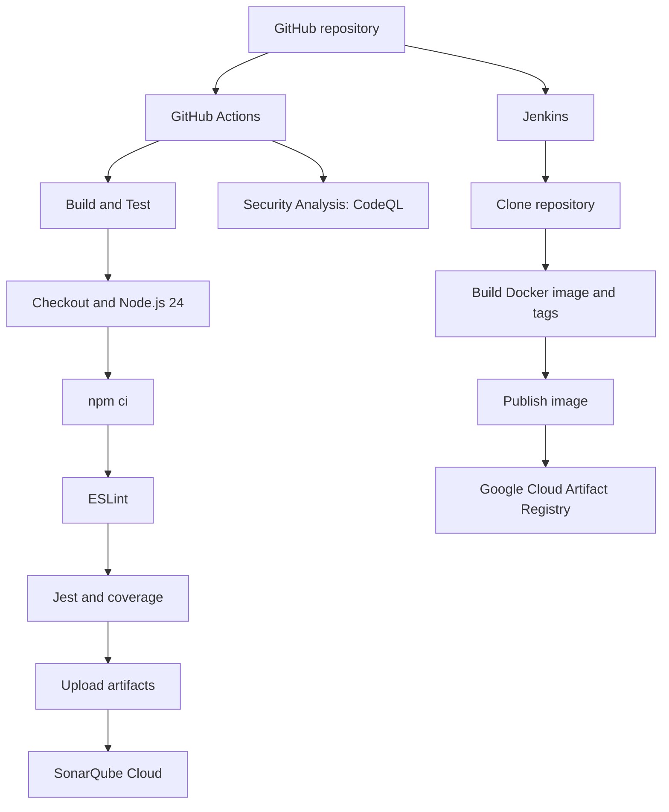

# GlucoCare API

[🇨🇴 Español](README.md) | **🇺🇸 English**

REST API built with Node.js and Express to retrieve patient information, insulin doses, and medications. This project is part of the DevOps Fundamentals course in the Master's in Software Architecture program at Universidad de La Sabana.

## Technologies

Node.js, Express, Jest, Supertest, ESLint, GitHub Actions, SonarQube Cloud, GitHub CodeQL, Jenkins, Docker, and Google Cloud Artifact Registry.

## Local setup

Requirements: Node.js 24 and npm.

```bash
git clone https://github.com/diefer91/glucocare-api.git
cd glucocare-api
npm ci
npm start
```

## Endpoints

| Method | Endpoint | Description |
|---|---|---|
| GET | `/` | Check API availability |
| GET | `/patients` | Retrieve patients |
| GET | `/patients/:id` | Retrieve a patient |
| GET | `/patients/:id/insulin-shots` | Retrieve insulin doses |
| GET | `/patients/:id/medications` | Retrieve medications |

The application uses in-memory data.

## Local checks

```bash
npm run lint
npm test
npm test -- --coverage
```

## CI/CD architecture



## Continuous integration (CI)

The [ci.yml](.github/workflows/ci.yml) workflow runs on `push` and `pull_request` events targeting `main`. It contains two independent jobs.

### Build and Test

1. Checkout with full Git history for SonarQube.
2. Configure Node.js 24 with npm caching.
3. Install dependencies using `npm ci`.
4. Run static analysis with ESLint.
5. Run automated Jest tests and generate coverage.
6. Organize reports by UTC date and time.
7. Upload `test-coverage-<run_id>` artifacts with seven-day retention.
8. Run quality analysis with SonarQube Cloud.

Report organization and upload steps use `if: always()` to attempt to preserve results even when an earlier check fails. Coverage is copied only if it exists.

### SonarQube Cloud

Analysis settings are defined in [sonar-project.properties](sonar-project.properties). SonarQube evaluates code quality, security, maintainability, duplication, and coverage through the Quality Gate. It requires the `SONAR_TOKEN` GitHub Actions secret. Analysis runs on pushes and pull requests from the same repository, not on pull requests from forks.

### Security Analysis

CodeQL runs as an independent job. It initializes JavaScript and TypeScript analysis with `build-mode: none` and publishes results to GitHub Code Scanning.

## Continuous delivery (CD)

The [Jenkinsfile](Jenkinsfile) defines three stages:

| Stage | Description |
|---|---|
| Clone repository | Retrieve source code from GitHub |
| Build Docker image | Build and tag the Docker image |
| Publish image | Publish the image to Google Cloud Artifact Registry |

Each image receives two tags: `IMAGE_TAG`, associated with the commit, and `BUILD_TAG`, associated with the Jenkins build number (`build-<number>`). Both tags are published to the registry to support traceability.

Image address format:

```text
LOCATION-docker.pkg.dev/PROJECT-ID/REPOSITORY/IMAGE:TAG
```

Publishing credentials must be configured in Jenkins and must not be stored in source code. CI and CD pipelines are independent; no automatic trigger between them is assumed.

## Validation scenarios

- Detection and correction of ESLint errors.
- Detection and correction of functional failures using Jest.
- Validation of the SonarQube Cloud Quality Gate.
- Execution of CodeQL security analysis.
- Docker image build and publication using Jenkins.

## Main project files

| File | Responsibility |
|---|---|
| `app.js`, `server.js` | API and server initialization |
| `tests/app.test.js` | Automated tests |
| `package.json`, `package-lock.json` | Dependencies and commands |
| `eslint.config.js` | Static analysis rules |
| `.github/workflows/ci.yml` | CI pipeline |
| `sonar-project.properties` | SonarQube configuration |
| `Dockerfile`, `.dockerignore` | Image build |
| `Jenkinsfile` | CD pipeline |
| `.gitignore` | Version control exclusions |

## Authors

- Camilo Andrés Ibarra Yepes
- Diego Fernando Vidal Illera

Master's in Software Architecture — Universidad de La Sabana.
