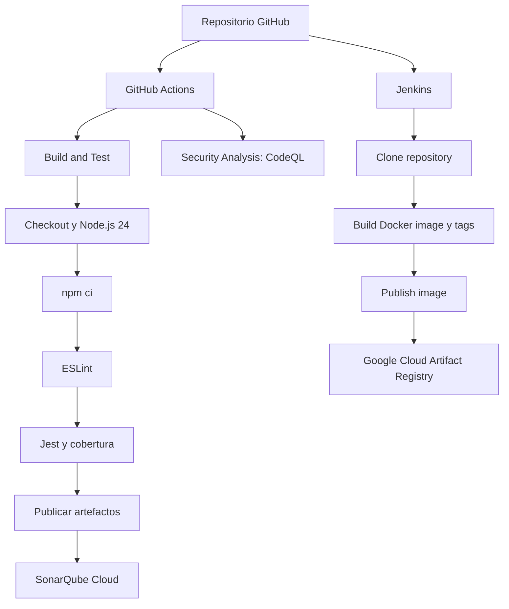

# GlucoCare API

**🇨🇴 Español** | [🇺🇸 English](README.en.md)

API REST desarrollada con Node.js y Express para consultar información de pacientes, dosis de insulina y medicamentos. Proyecto de la asignatura Fundamentos DevOps de la Maestría en Arquitectura de Software de la Universidad de La Sabana.

## Tecnologías

Node.js, Express, Jest, Supertest, ESLint, GitHub Actions, SonarQube Cloud, GitHub CodeQL, Jenkins, Docker y Google Cloud Artifact Registry.

## Instalación y ejecución local

Requisitos: Node.js 24 y npm.

```bash
git clone https://github.com/diefer91/glucocare-api.git
cd glucocare-api
npm ci
npm start
```

## Endpoints

| Método | Endpoint | Descripción |
|---|---|---|
| GET | `/` | Verificar el funcionamiento de la API |
| GET | `/patients` | Consultar pacientes |
| GET | `/patients/:id` | Consultar un paciente |
| GET | `/patients/:id/insulin-shots` | Consultar dosis de insulina |
| GET | `/patients/:id/medications` | Consultar medicamentos |

La aplicación utiliza datos almacenados en memoria.

## Validaciones locales

```bash
npm run lint
npm test
npm test -- --coverage
```

## Arquitectura CI/CD



## Integración continua (CI)

El workflow [ci.yml](.github/workflows/ci.yml) se ejecuta ante eventos `push` y `pull_request` asociados a `main`. Contiene dos jobs independientes.

### Build and Test

1. Checkout con historial completo para SonarQube.
2. Configuración de Node.js 24 con caché de npm.
3. Instalación de dependencias mediante `npm ci`.
4. Análisis estático mediante ESLint.
5. Pruebas automatizadas con Jest y generación de cobertura.
6. Organización de reportes por fecha y hora UTC.
7. Publicación de artefactos `test-coverage-<run_id>` con retención de siete días.
8. Análisis de calidad mediante SonarQube Cloud.

Las etapas de organización y publicación de reportes utilizan `if: always()` para intentar conservar los resultados incluso cuando falla una validación anterior. Solo se copia la cobertura si existe.

### SonarQube Cloud

La configuración se encuentra en [sonar-project.properties](sonar-project.properties). El análisis evalúa calidad, seguridad, mantenibilidad, duplicación y cobertura mediante el Quality Gate. Requiere el secreto `SONAR_TOKEN` en GitHub Actions. Se ejecuta en pushes y Pull Requests del mismo repositorio, no en Pull Requests procedentes de forks.

### Security Analysis

CodeQL se ejecuta como un job independiente. Inicializa el análisis de JavaScript y TypeScript con `build-mode: none` y publica los resultados en GitHub Code Scanning.

## Entrega continua (CD)

El [Jenkinsfile](Jenkinsfile) define tres etapas:

| Stage | Descripción |
|---|---|
| Clone repository | Obtener el código fuente desde GitHub |
| Build Docker image | Construir y etiquetar la imagen Docker |
| Publish image | Publicar la imagen en Google Cloud Artifact Registry |

Cada imagen recibe dos etiquetas: `IMAGE_TAG`, asociada al commit, y `BUILD_TAG`, asociada al número de ejecución de Jenkins (`build-<número>`). Ambas se publican en el registro, facilitando la trazabilidad.

Formato de la dirección de la imagen:

```text
LOCATION-docker.pkg.dev/PROJECT-ID/REPOSITORY/IMAGE:TAG
```

Las credenciales de publicación deben configurarse en Jenkins y no almacenarse en el código fuente. Los pipelines CI y CD son independientes; no se presupone un disparador automático entre ellos.

## Escenarios de validación

- Detección y corrección de errores de ESLint.
- Detección y corrección de fallos funcionales mediante Jest.
- Validación del Quality Gate de SonarQube Cloud.
- Ejecución del análisis de seguridad con CodeQL.
- Construcción y publicación de imágenes Docker mediante Jenkins.

## Archivos principales

| Archivo | Responsabilidad |
|---|---|
| `app.js`, `server.js` | API e inicialización del servidor |
| `tests/app.test.js` | Pruebas automatizadas |
| `package.json`, `package-lock.json` | Dependencias y comandos |
| `eslint.config.js` | Reglas de análisis estático |
| `.github/workflows/ci.yml` | Pipeline CI |
| `sonar-project.properties` | Configuración de SonarQube |
| `Dockerfile`, `.dockerignore` | Construcción de la imagen |
| `Jenkinsfile` | Pipeline CD |
| `.gitignore` | Exclusiones del control de versiones |

## Autores

- Camilo Andrés Ibarra Yepes
- Diego Fernando Vidal Illera

Maestría en Arquitectura de Software — Universidad de La Sabana.
